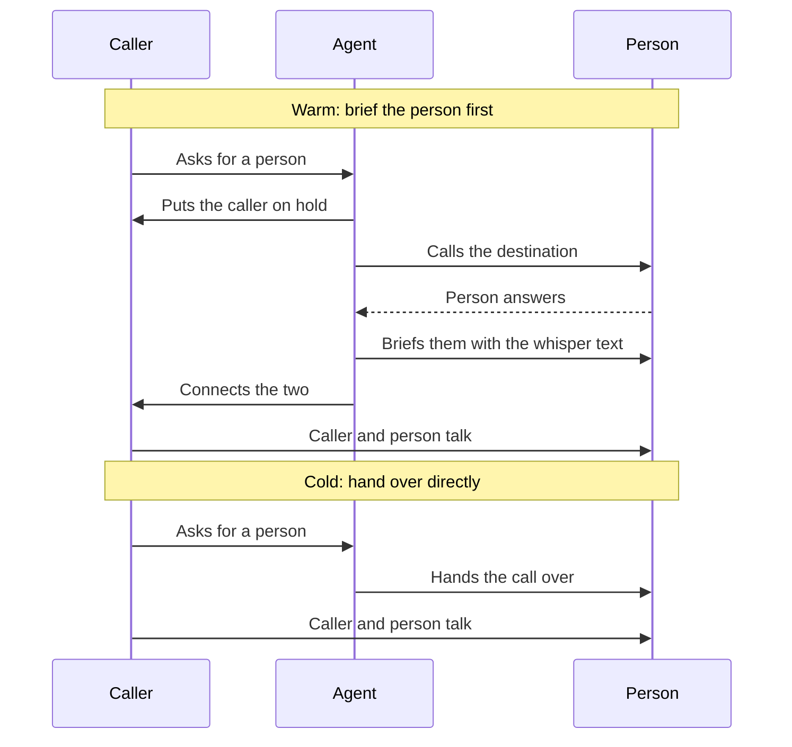
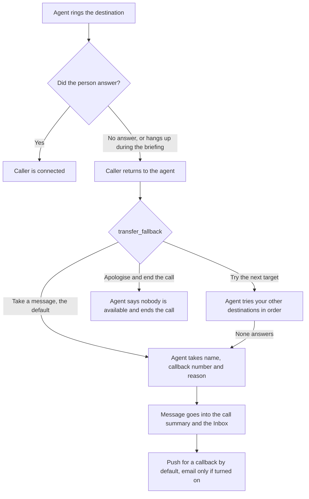

An agent can transfer a call to a person.
You set this up with a transfer tool on the agent version, listing the destinations the agent may use.

## Destinations

Each destination has:

| Field | Meaning |
| - | - |
| `name` | The agent picks a destination by this name. |
| `description` | When to use it. The agent reads this. |
| `e164` or `sip_uri` | Where to send the call. Set exactly one. |
| `mode` | `cold` or `warm`. |
| `ring_timeout_seconds` | How long to ring the person before returning to the caller. The default is 25. |
| `whisper` | Warm transfers only: what the agent says to the person before connecting. |

Use a number that doesn't forward back to Larynth, such as a cell.
Your main line usually forwards to us, so calls sent there would loop.
Saving your Larynth number or the line that forwards to it is refused.

## Cold transfer

The caller is handed over directly.
A `sip_uri` destination works for cold transfers only.

## Warm transfer

The agent puts the caller on hold, calls the person, briefs them, and then connects the two.
In `whisper` you can use the variables `{{summary}}` and `{{destination}}`.

## Press 0 or ask for a person

On phone calls, callers can reach a person without waiting for the agent to decide.
They press 0, or say something like "talk to a person" or "real person".
The agent says it is connecting them and transfers to your first destination.
Both are on by default once the agent has a transfer number.
They need a destination that reaches a person directly, not one that forwards back to Larynth.
You can turn each off in the agent's call handling settings.
They work after any notices the agent must play first.

## Only during business hours

Turn on **Only during business hours** to stop transfers outside your opening hours.
Outside those hours, the agent tells the caller nobody is available and takes a message instead.

## When nobody answers

If the person does not answer, or hangs up during the briefing, the caller returns to the agent.
What happens next depends on **If nobody picks up** (`transfer_fallback`):

| Setting | What happens |
| - | - |
| Take a message (default) | The agent takes the caller's name, callback number and reason, and reads the number back. |
| Try the next target | The agent tries your other destinations in order, then takes a message if none answers. |
| Apologise and end the call | The agent tells the caller nobody is available, says goodbye and ends the call. |

The agent only takes the message in the conversation.
After the call, the message is in the call summary and in the Inbox, as a `message` item, or a `callback` item if the caller asked to be called back.
A callback sends the `inbox.callback_waiting` notification, which is push by default.
Email is sent only if you turn it on in notification settings.

## Recording after a transfer

Recording continues on both sides after a warm transfer, unless you have turned recording off for the agent.
Tell your staff that calls are recorded.

## Tips

- Write each destination `description` as a plain rule, such as "billing questions during business hours".
- Browser test calls can't transfer. To test a transfer, call your number from a phone.
