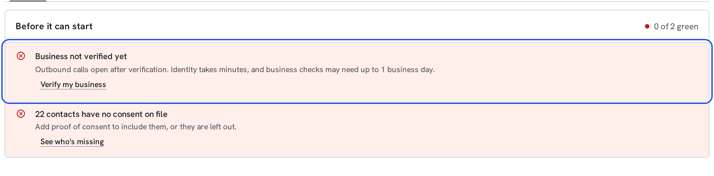

Outbound means your agent places the call. You can place one call with `POST /v1/calls`, or run a campaign that calls a list of contacts inside the hours you set.

<Warning>
  Only call people who gave the consent your calls need. Larynth enforces its checks, but you are the caller and the legal responsibility stays with you.
</Warning>

## Before you can call

Outbound is closed until the account passes these gates. Unverified accounts can only receive calls.

| Gate | What it needs |
| - | - |
| Verification | Individual or business verification. Campaigns need a verified business. See [Go live and verification](/help/go-live-and-verification). |
| Paid top-up | Paid credit on the account. Free credit can't be used for outbound calls. |
| Outbound terms | The current outbound terms accepted. |
| Marketing approval | Only for the `telemarketing` purpose. |
| Agent published | The campaign's agent has a published version. |
| Script check | The agent's outbound script check is not `blocked` or `flagged`. |
| Caller ID | A Larynth number that is active and yours. Imported numbers can't be a caller ID. |

## Who can run campaigns

Every campaign needs a verified business. Identity and business verification must both be approved.

Workspaces on the individual path can't start campaigns.

Informational campaigns are open to verified businesses. These are reminders, confirmations and follow-ups the contact asked for.

Telemarketing needs separate approval. It is not offered at present.

Larynth is not for HIPAA covered entities, such as clinics, dentists and therapists.

## Preflight

<Frame caption="Preflight lists what blocks a campaign.">
  
</Frame>

Check a campaign before you launch it. `POST /v1/campaigns/preflight` checks an unsaved draft, and `GET /v1/campaigns/{id}/preflight` checks a saved campaign. Nothing is written. The result has `can_launch` and a list of checks. Each check has a state of `ok`, `warn`, `stop` or `info`, and often a link to fix it.

Preflight is a forecast. Every dial is checked again when it happens.

The checks cover the gates above and these:

| Check | What it looks at |
| - | - |
| `audience` | The contacts you picked. |
| `consent_coverage` | Whether contacts have consent on file. |
| `dnc_internal`, `dnc_national` | Your Do-Not-Call list, and the national registry data for marketing. |
| `calling_hours` | Allowed hours in each contact's local time. |
| `frequency_cap` | Limits on how often one person is called in 24 hours. |
| `holidays_sundays` | State rules for holidays and Sundays. |
| `ca_preamble` | The extra opening required for some California contacts. |
| `state_registrations` | State registrations for marketing calls into states that require them. |
| `voicemail_optout_line` | An opt-out line for marketing voicemail messages. |
| `balance`, `daily_spend_cap` | Enough credit, and room under your daily cap. |
| `recheck_due` | A business re-check that is coming up. |

`GET /v1/compliance/calling-rules` returns the calling rules applied for each US state.

## Run a campaign

<Steps>
  <Step title="Add contacts and record consent">
    Create contacts with `POST /v1/contacts`, or import a CSV with `POST /v1/contacts/imports`. Record consent for each person. Individuals can't upload lists. See [Outbound with consent](/guides/outbound-with-consent) for the full steps with examples.
  </Step>

  <Step title="Create the campaign">
    `POST /v1/campaigns` takes a name, an agent, the numbers to call from, a purpose (`informational` or `telemarketing`), calling windows, retry rules and the voicemail behavior (`amd_mode`). `POST /v1/campaigns/audience-preview` previews who would be called, and `POST /v1/campaigns/estimate` estimates the size and cost.
  </Step>

  <Step title="Run preflight">
    Fix every `stop` before launch. A `warn` does not block.
  </Step>

  <Step title="Start">
    `POST /v1/campaigns/{id}/start`. Contacts are checked one at a time as they come up. A contact that fails a check is skipped, or held until the check can pass, for example until the calling window opens.
  </Step>

  <Step title="Watch and control it">
    `GET /v1/campaigns/{id}/stats` returns the counters, and `GET /v1/campaigns/{id}/events` returns a readable timeline of what happened. Pause with `POST /v1/campaigns/{id}/pause` (calls in progress continue) and resume with `.../resume`.
  </Step>
</Steps>

## Safeguards on every call

- Calls go out between 8 am and 9 pm in the contact's local time.
- State rules can narrow those hours. California is 9 am to 9 pm. Indiana is 9 am to 8 pm. Minnesota is 9 am to 9 pm. North Dakota is 8 am to 9 pm.
- No calls on Sundays or state holidays. The exception is an informational call the contact asked for.
- At most 3 calls per contact in 24 hours.
- At most 1 call a day per contact for marketing.
- A campaign pauses on its own when opt-outs or complaints pass a threshold.

## Consent proof

You may be asked for the consent proof behind an uploaded list. Send it within 5 business days.

For a complaint or traceback, send it within 2 business days.

If proof is not provided, Larynth can suspend your campaigns.

## Paused for readiness

A running campaign pauses itself if the workspace stops meeting the requirements. Its `paused_reason` is `readiness`.

The campaign shows what blocks it. Fix the blocker, then resume.

Resume is refused while the workspace is still blocked.

## Safety pauses

Larynth watches campaigns for signs of a problem, such as many opt-outs, complaints or very short calls. A campaign can pause itself. You can ask for a review, and our team decides within about one business day. Only our team can resume a campaign paused for a safety reason. You can resume a campaign paused for the schedule, your balance, or by you.

## When someone asks to stop

An opt-out is recorded straight away, the number joins your Do-Not-Call list, and it is not called again. Record opt-outs you receive another way with `POST /v1/compliance/revocations`. A `compliance.opt_out` [webhook](/webhooks/events) is sent.

## Limits

Outbound limits depend on your verification level. See the table in [Go live and verification](/help/go-live-and-verification#limits-by-level).

Outbound calls to emergency numbers are blocked.
