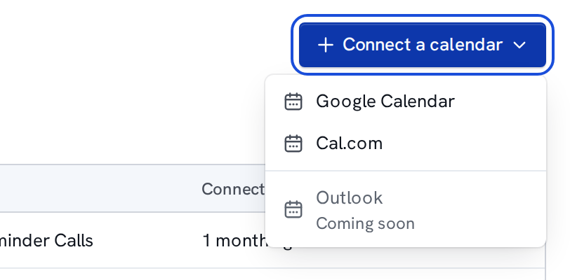
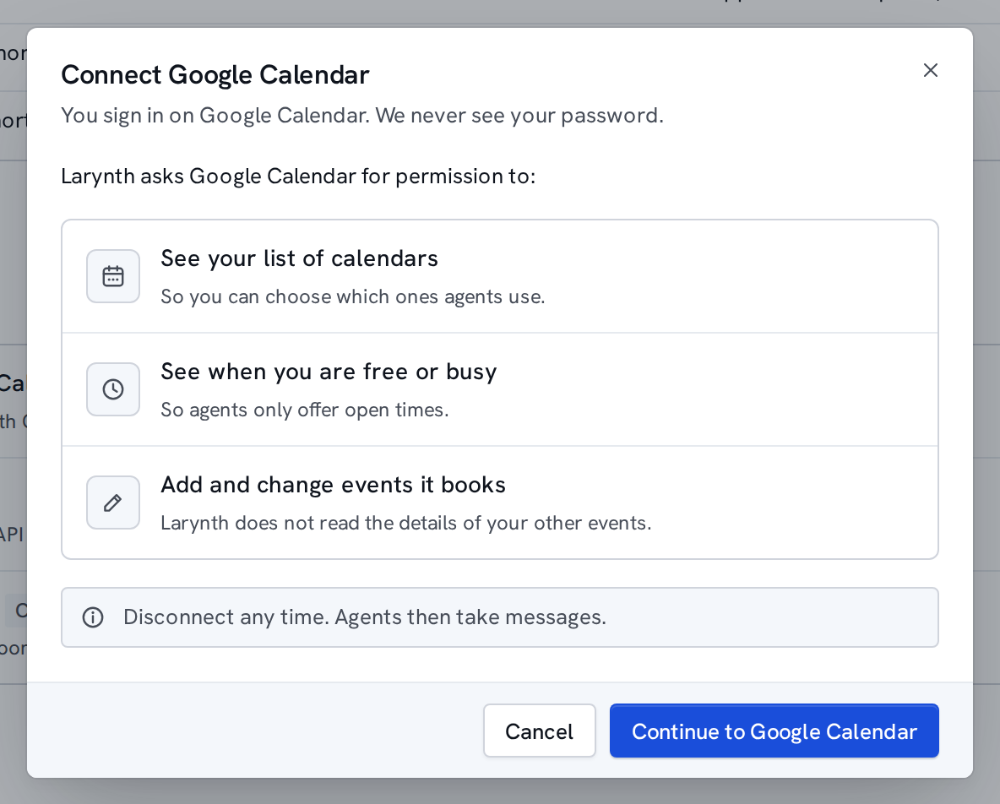
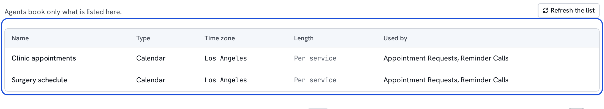
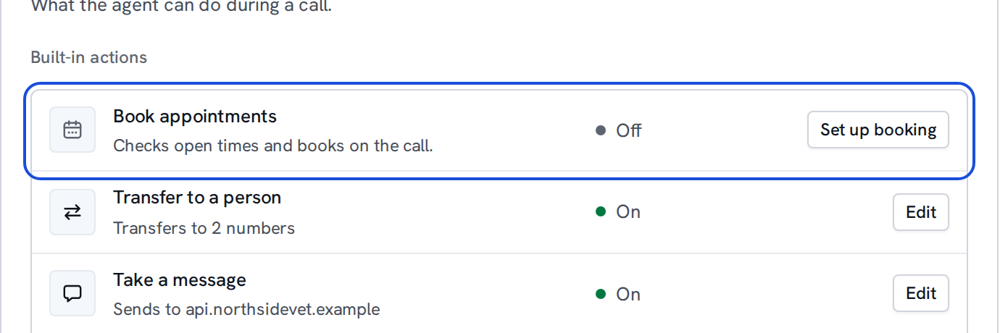
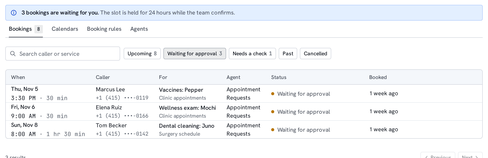
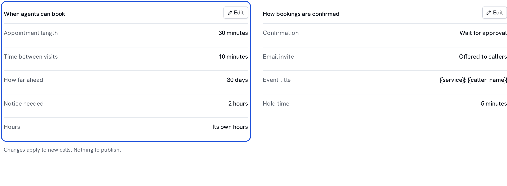

Connect a calendar and your agent can book appointments during the call, instead of only taking a message.
Larynth works with Google Calendar and Cal.com.
Outlook is not available yet.

An Owner or Admin connects calendars.

## Connect Google Calendar

<Steps>
  <Step title="Open Calendars">
    In the dashboard, go to **Tools** ▸ **Calendars**.
    Click **Connect a calendar** and choose **Google Calendar**.

    <Frame caption="Open Connect a calendar and choose a provider.">
      
    </Frame>
  </Step>

  <Step title="Sign in with Google">
    The dialog lists what Larynth asks for: to see your list of calendars, to see when you are free or busy, and to add and change the events it books.
    Larynth does not read the details of your other events.
    Click **Continue to Google Calendar**, sign in, and allow all three permissions.

    <Frame caption="Larynth asks for three permissions.">
      
    </Frame>
  </Step>

  <Step title="Choose the calendars agents may use">
    You return to the dashboard.
    On the **Calendars** tab, choose which calendars agents may book.
    Agents book only what is listed there.

    <Frame caption="Agents book only the calendars listed here.">
      
    </Frame>
  </Step>

  <Step title="Check the booking rules">
    Open the **Booking rules** tab and check the defaults.
    See [Booking rules](#booking-rules) below.
  </Step>
</Steps>

## Connect Cal.com

<Steps>
  <Step title="Make an API key in Cal.com">
    In Cal.com, go to **Settings**, **Developer**, **API keys**, and make a key for Larynth.
  </Step>

  <Step title="Paste the key">
    In the dashboard, go to **Tools** ▸ **Calendars**.
    Click **Connect a calendar**, choose **Cal.com**, paste the key, and click **Check and connect**.
  </Step>

  <Step title="Choose the event types">
    On the **Calendars** tab, choose which event types agents may book.
    An event type's own length is used for its appointments.
  </Step>
</Steps>

## Turn on booking for your agent

A connected calendar does nothing until an agent uses it.

<Steps>
  <Step title="Open the agent">
    Go to **Agents** and open the agent.
  </Step>

  <Step title="Set up booking">
    On the **Actions** tab, find **Book appointments** and click **Set up booking**.
    Choose the calendar connection and the calendar or event type.

    <Frame caption="Turn on Book appointments on the agent.">
      
    </Frame>
  </Step>

  <Step title="Add your services (optional)">
    Under **Services**, list what callers can book, each with its length.
    The agent offers them by name.
    You can add up to 20.
  </Step>

  <Step title="Publish">
    Click **Add to agent**, then **Publish**.
    Changes are saved to the draft and reach calls only after you publish.
  </Step>
</Steps>

## What the agent does on a call

- **Finds a time.**
  It looks up open times, by default in the next seven days, and offers the caller up to three.
- **Holds it.**
  It asks for the caller's name and holds the time for a few minutes while the caller decides.
- **Books it.**
  It reads back the day, time and name, and books only after a clear yes.
- **Sends an invite, if you allow it.**
  It can offer once to email the caller a calendar invite, and spells the address back to check it.
- **Reschedules or cancels.**
  It finds upcoming bookings made from the number the caller is calling from, and moves or cancels the one they choose.

The agent only says a time is booked when the calendar confirms it.
If booking fails, or the caller prefers it, the agent takes a message instead.

### Changes by phone need the name on the booking

Caller ID alone is not enough to change a booking.
Before it moves or cancels anything, the agent asks for the name on the booking.
The caller gets two tries per call.

The agent can only change bookings made through Larynth, from the same phone number, on the same calendar.

When a caller changes a booking by phone, you get an item in your **Inbox**.
If the caller gave an email address, they also get a receipt with a link to restore the booking if it was not them.

## Wait for approval

<Frame caption="Bookings wait for a yes.">
  
</Frame>

You can have the agent ask before it books.

- For every agent on a calendar: open the calendar, go to **Booking rules**, and set **Confirmation** to **Wait for approval**.
- For one agent: in the agent's booking settings, set **Confirmation** to **Wait for approval**.

With approval on, the agent tells the caller the team will confirm.
The time is held on your calendar as tentative.
You get a notification and an item in your **Inbox** with **Confirm** and **Decline**.

The time stays on hold for 24 hours.
The caller is not contacted when you confirm or decline, so let them know yourself.

## If your calendar disconnects

If Google or Cal.com stops accepting Larynth's access, for example because access was removed or the API key was deleted, the calendar shows **Needs reconnecting**.

- Your agents take messages instead of booking until you reconnect.
- Existing bookings stay.
- You see an item in your **Inbox** saying the calendar stopped syncing.

To fix it, go to **Tools** ▸ **Calendars**, open the calendar, and click **Reconnect**.

To disconnect a calendar on purpose, open it and choose **Disconnect** from the more actions menu.
If a live agent books on it, remove it from that agent and publish first.

## Booking rules

<Frame caption="Set length, gaps, notice and hours.">
  
</Frame>

Each calendar connection has booking rules.
Find them under **Tools** ▸ **Calendars**, then open the calendar and go to **Booking rules**.
Changes apply to new calls, with nothing to publish.

| Rule | What it does | Default |
| - | - | - |
| **Appointment length** | Used when the service has no length of its own. | 30 minutes |
| **Time between visits** | Kept free after each booking. | None |
| **How far ahead** | The furthest day an agent will offer. | 14 days |
| **Notice needed** | No bookings that start sooner than this. | 1 hour |
| **Hours** | When agents may offer times. | Same as the phone number |
| **Confirmation** | Book right away, or wait for approval. | Book right away |
| **Hold time** | How long a time is held while the caller decides. | 5 minutes |

## Why does it say I'm fully booked?

The agent only offers a time when all of these are true:

- **The calendar shows you free.**
  Larynth checks only the calendars or event types you chose.
  Any event on them that shows you as busy blocks that time, including an all-day event.
- **The whole appointment fits inside your hours.**
  With **Same as the phone number**, agents use the business hours of the number the caller dialled.
  That includes days you marked closed and US federal holidays, if you turned them on.
- **There is room for the gap.**
  The **Time between visits** after the appointment must be free too.
- **It is far enough ahead.**
  Times sooner than **Notice needed** are skipped.
- **It is not too far ahead.**
  Times past **How far ahead** are skipped.
- **Nobody else has it.**
  Times held for another caller, or waiting for your approval, count as taken.

What to check:

<AccordionGroup>
  <Accordion title="An all-day event is blocking the day">
    In Google Calendar, an all-day event that shows you as busy blocks the whole day.
    Set events like that to show you as free, or keep them on a calendar agents don't use.
  </Accordion>

  <Accordion title="The hours are too narrow">
    Check the number's **Business hours** under **Phone numbers**.
    If an appointment runs past closing time, it is not offered.
    Or set the calendar's **Hours** to **Its own hours**.
  </Accordion>

  <Accordion title="The gap or the notice is too long">
    A long **Time between visits** or **Notice needed** can rule out most of a day.
    Lower them and try again.
  </Accordion>

  <Accordion title="The wrong calendar is chosen">
    Open the calendar and check the **Calendars** tab.
    If you share a calendar with your family or team, its events block your times too.
  </Accordion>

  <Accordion title="Cal.com shows no times">
    With Cal.com, the event type's own availability in Cal.com also applies.
    Check its schedule and limits in Cal.com.
  </Accordion>

  <Accordion title="The calendar needs reconnecting">
    A disconnected calendar can't be checked, so the agent takes a message.
    Reconnect it under **Tools** ▸ **Calendars**.
  </Accordion>
</AccordionGroup>

## If Google does not finish connecting

- **"Some permissions were not granted"**: connect again and allow all three permissions.
- **"Your organization blocked the connection"**: your Google Workspace admin has to allow Larynth first.
- **"That sign-in link has expired"**: the link works for ten minutes in one browser.
  Start again.

Still stuck?
Email [support@larynth.com](mailto:support@larynth.com).
