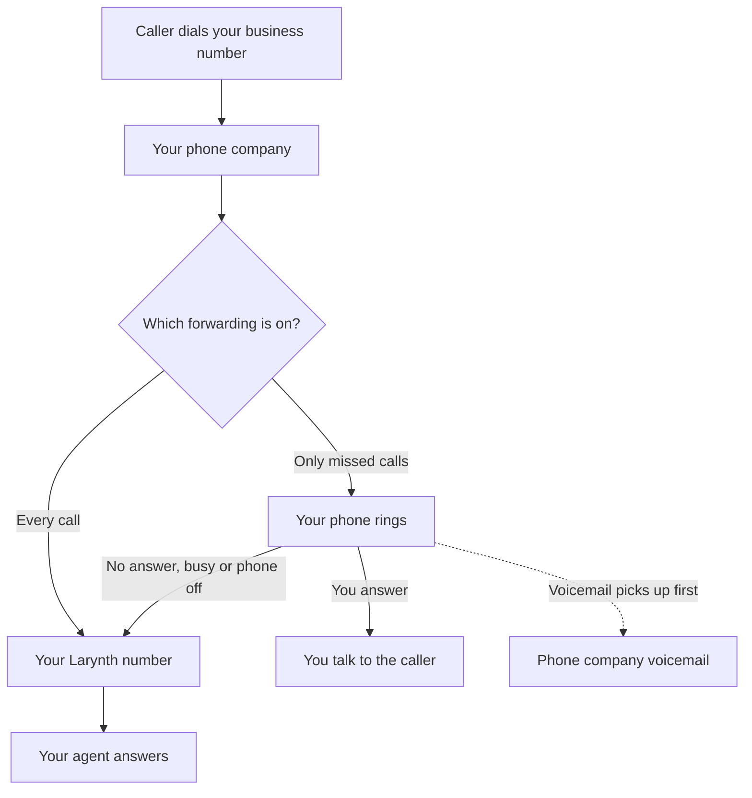

You keep your business number.
Your phone company sends its calls to your Larynth number, and the agent answers.
This page lists the steps for the phone companies we could confirm on their own support pages.
For the general idea, see [Forward your number](/help/forward-your-number).

<Note>
  Forwarding is a setting at your phone company, not in Larynth.
  Larynth cannot turn it on or off for you.
  Codes can change, so check your phone company's help page if one does not work.
</Note>

## Before you start

- Your Larynth number must show **Active** on the **Phone numbers** page.
- A published agent must answer that number.
- Call the Larynth number directly once and check that the agent picks up.
- Have the Larynth number ready as 10 digits, such as `4155550100`.

## All calls, or only missed calls

| Choice | What happens | Good for |
| - | - | - |
| All calls | Your phone stops ringing and the agent answers everything. | After hours, holidays, or a line nobody staffs. |
| Only missed calls | Your phone rings first and the agent answers when you are busy or do not pick up. | Teams that want to answer when they can. |

"Only missed calls" can be one setting or three, depending on the phone company.
Some have separate settings for no answer, busy, and phone off or out of signal.
Set all three, or some missed calls still go to voicemail.

The dashboard uses the same two choices.
Open **Phone numbers**, open your number, and next to **Forward your existing number** select **Open**.
Under **What should be forwarded?** pick **Every call** or **Only when I don't answer**.
The codes shown there are common defaults.
If your phone company is listed below, use the codes on this page.

## Find your phone company

Pick the kind of phone service you have, then open your phone company.

<Tabs>
  <Tab title="Mobile">
    Dial each code from the phone whose number you are forwarding, then press call.

    <AccordionGroup>
      <Accordion title="AT&T wireless">
        Turn forwarding on in your phone's own call settings.
        To turn forwarding off for all calls, dial `#21#` and press call.
        Wait at least three seconds for the confirmation tone before you hang up.

        On phones that offer them, the options are **When busy**, **When unanswered** and **When unreachable**.
        AT&T says unanswered calls forward "after a few rings" and does not list a way to change that.
        If your phone does not show these options, ask AT&T to set them.
      </Accordion>

      <Accordion title="Verizon wireless">
        | What | Dial |
        | - | - |
        | All calls, on | `*72` then the 10-digit number |
        | Busy or no answer, on | `*71` then the 10-digit number |
        | Off | `*73` |

        Listen for the beeps and let the call end by itself.
        The `*71` code covers busy and no answer together.
        Verizon says unanswered calls forward after 3 to 6 rings and does not list a way to change that.
        The confirmation for `*73` can sound like a busy signal.
        You need the phone in hand, or Verizon customer service can set it for you.
      </Accordion>

      <Accordion title="T-Mobile">
        T-Mobile's codes include a `1` before the number.

        | What | On | Off |
        | - | - | - |
        | All calls | `**21*1` then the number, then `#` | `##21#` |
        | No answer | `**61*1` then the number, then `#` | `##61#` |
        | Phone off or out of signal | `**62*1` then the number, then `#` | `##62#` |
        | Busy | `**67*1` then the number, then `#` | `##67#` |

        For "only missed calls", set no answer, phone off and busy.

        You can choose how long your phone rings before the call forwards.
        Dial `**61*1`, the number, `**`, the seconds, then `#`.
        T-Mobile allows 5, 10, 15 and so on, up to 30 seconds.
        For example, `**61*14155550100**20#` forwards after 20 seconds.

        To undo everything, dial `##004#`.
        T-Mobile describes this as resetting call forwarding to default.
      </Accordion>

      <Accordion title="US Cellular and other carriers">
        We could not confirm codes for US Cellular on the carrier's own pages, so we do not list any.
        The same goes for prepaid brands.
        Look for **Call forwarding** in the phone's call settings, or ask the carrier for "call forwarding to an outside number".
      </Accordion>
    </AccordionGroup>
  </Tab>

  <Tab title="Business phone service">
    <AccordionGroup>
      <Accordion title="Comcast Business">
        These codes come from Comcast Business guides for its hosted phone systems.
        Pick up the handset, dial the code, then enter the 10-digit number.

        | What | On | Off |
        | - | - | - |
        | All calls | `*72` | `*73` |
        | No answer | `*92` | `*93` |
        | Busy | `*90` | `*91` |

        On Business VoiceEdge you can also use the online portal.
        Open **Feature Settings**, choose **Call Forwarding**, enter the number and switch it **On**.
        Switch it **Off** there to undo it.
        Comcast's guide does not say how many rings pass before a no-answer forward.
        If the codes do not work on your line, ask Comcast Business to turn on call forwarding.
      </Accordion>

      <Accordion title="RingCentral">
        RingCentral uses settings, not dial codes.
        You may need permission from your account administrator.

        <Steps>
          <Step title="Open call handling">
            In the RingCentral app, go to **Settings**, then **Phone**.
            Select **Edit** next to **Call handling**.
          </Step>

          <Step title="Choose what to forward">
            For all calls, turn on **Forward all calls**, choose **Contact or phone number** and enter your Larynth number.

            For missed calls only, set **Ring for** to how long your devices should ring.
            Then under **Missed calls** choose **Forward to external number** and enter your Larynth number.
          </Step>

          <Step title="Save">
            Select **Save**.
          </Step>
        </Steps>

        To undo it, turn **Forward all calls** off, or set **Missed calls** back to **Send to voicemail**.

        RingCentral can also play a prompt that asks the person answering to press a key.
        An agent cannot press keys, so turn that off.
        See [Google Voice, VoIP and phone systems](/help/google-voice-and-phone-systems).
      </Accordion>
    </AccordionGroup>
  </Tab>

  <Tab title="Landline">
    <AccordionGroup>
      <Accordion title="AT&T home phone">
        | What | Dial |
        | - | - |
        | All calls, on | `*72` or `72#`, wait for the dial tone, then enter the number |
        | All calls, off | `*73` or `73#` |

        After the confirmation tone, AT&T calls the number you entered.
        Forwarding turns on only when that call is answered.
        If the line is busy or nobody answers, repeat the steps.
        So set up your agent first, and let it answer.

        Busy and no-answer forwarding have no dial code on AT&T home phone lines.
        AT&T asks you to call 800.288.2020 so an agent can set them.
      </Accordion>

      <Accordion title="Verizon home phone">
        | What | Dial |
        | - | - |
        | All calls, on | `*72`, wait for the tone, then dial the number |
        | All calls, off | `*73` |

        Forwarding turns on when the call to that number is answered.
        If it is busy, dial again.
        You hear two short tones when forwarding is on, and again when you turn it off.

        Busy and no-answer forwarding is a separate Verizon feature.
        In most areas the forwarding number is fixed by Verizon, and changing it needs a service request.
        Where Verizon lets you switch it yourself, `*90` turns it on and `*91` turns it off.
        Calls forward after a preset number of rings.
        Verizon notes that forwarded calls can carry local or toll charges.
      </Accordion>
    </AccordionGroup>
  </Tab>
</Tabs>

## Test it

<Steps>
  <Step title="Open the test in the dashboard">
    Open **Phone numbers** and open your Larynth number.
    Next to **Forward your existing number**, select **Open**.
    Scroll to **Test it.**
  </Step>

  <Step title="Call your own business number">
    Use a different phone from the one you forward.
    For "only missed calls", let it ring and do not answer.
  </Step>

  <Step title="Check the result">
    The agent should answer.
    The page shows **Call received.** when the call arrives.
    It adds "It arrived through forwarding." when your phone company tells us the call was forwarded.
  </Step>
</Steps>

After a forwarded call arrives, the **Forwarding works** step on the **Go live** page is marked done.
The number's page also shows which line forwards to it.
Some phone companies do not pass along that a call was forwarded.
The call still reaches your agent, but the step stays open.

## Undo forwarding

Use the "off" code or setting for your phone company above.
Then call your business number and check that your own phone rings.

Turn forwarding off before you release a Larynth number.
Otherwise callers reach a number that no longer answers.

## If it does not work

- Calls still reach voicemail: see [My calls still go to voicemail](/help/calls-go-to-voicemail).
- Something asks the agent to "press 1": see [Google Voice, VoIP and phone systems](/help/google-voice-and-phone-systems).
- Still stuck: contact [support](/help/support) with the number you forward from and the name of your phone company.
