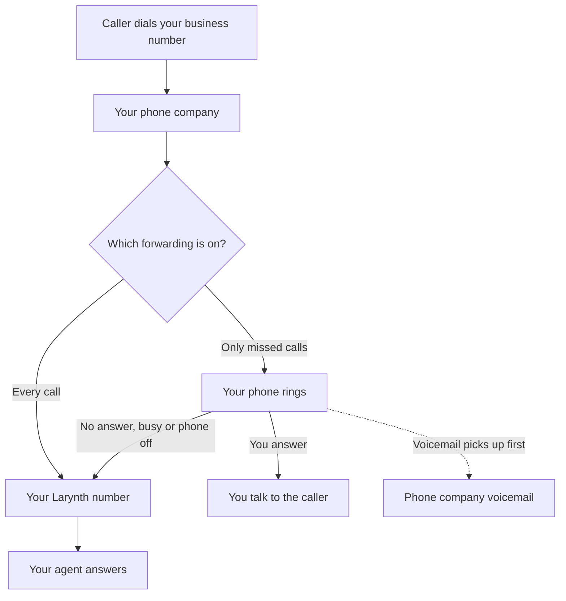
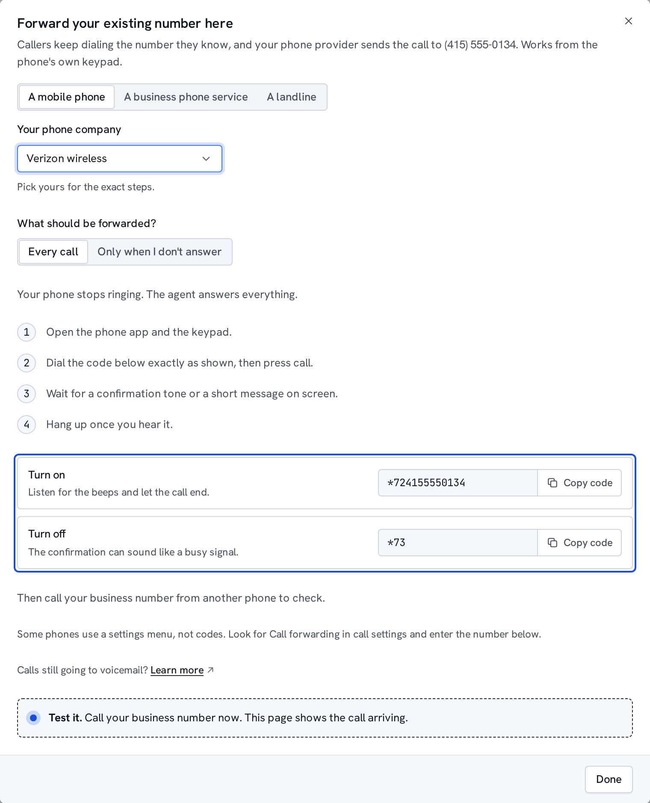

You do not need to move your business number. Order a Larynth number, then set your current phone service to forward calls to it. Callers still dial the number they know.

Larynth does not port numbers yet, so forwarding is the way to keep your existing number.

This is the path of a forwarded call.
The dotted line is the problem [My calls still go to voicemail](/help/calls-go-to-voicemail) fixes.

<Steps>
  <Step title="Order a Larynth number">
    Order a US or Canadian number and route it to your published agent. Wait until its status is `active`. See [Get a number](/help/get-a-number).
  </Step>

  <Step title="Test the Larynth number directly">
    Call the new number from your mobile phone. Confirm the agent answers and behaves as you expect before you forward anything.
  </Step>

  <Step title="Set up forwarding with your provider">
    In your current phone service, forward calls to the Larynth number. Choose what to forward:

    - **Every call**, so the agent answers every call.
    - **Only when I don't answer**, so calls reach the agent when you don't pick up.

    Each provider names these differently, such as "call forwarding", "unconditional forwarding" or "no-answer forwarding". Use your provider's help pages for the exact steps. Mobile carriers usually support forwarding with a short dial code.

    <Frame caption="Dial the turn-on code, then check it.">
      
    </Frame>
  </Step>

  <Step title="Call your business number">
    Dial your own business number from a different phone. The call should reach the agent.
  </Step>
</Steps>

## Tips

- Choose Only when I don't answer if you want your team to pick up first.
- Add a [handoff](/concepts/handoff) destination so the agent can pass urgent calls to a person.
- Turn forwarding off at your provider to stop sending calls to Larynth.

## If it does not work

- Check that the Larynth number is `active`.
- Check that the number routes to an agent with a published version.
- Some providers limit forwarding to numbers on the same account type or region. Ask your provider.
- If calls reach the agent but the caller ID shows your own number or is blank, that comes from the forwarding setup at your provider.

Still stuck? Email [support@larynth.com](mailto:support@larynth.com) with the number you are forwarding from and your provider.
