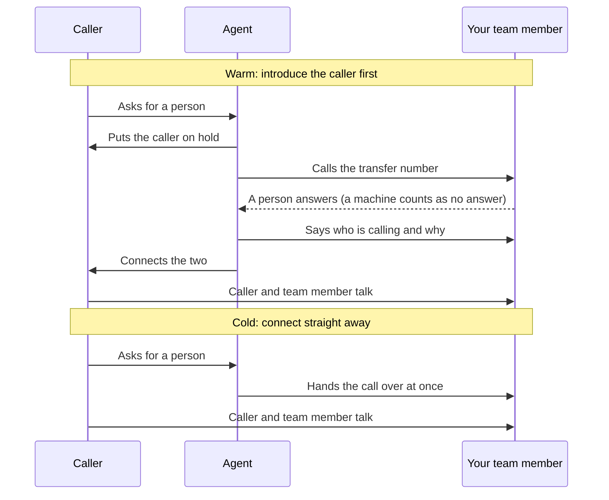
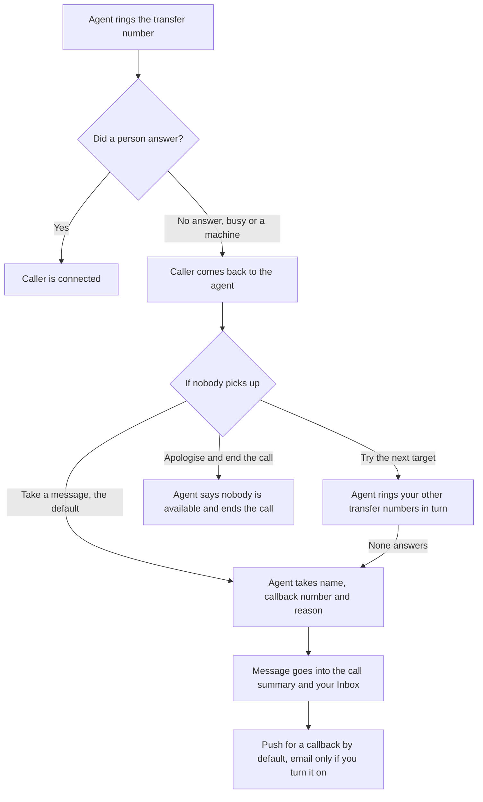
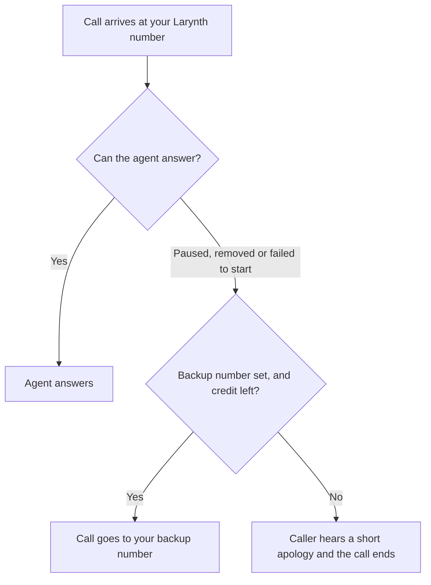

Your agent can pass a call to someone on your team.
You choose the numbers it can transfer to, how it connects, and what happens if nobody picks up.

## Set a transfer number

<Steps>
  <Step title="Open the agent">
    Go to **Agents** and open the agent.
  </Step>

  <Step title="Open the transfer settings">
    On the **Actions** tab, find **Transfer to a person** and click **Set up**, or **Edit** if a number is already there.
  </Step>

  <Step title="Add the number">
    Click **Add a transfer number** and fill in:

    - **Name**: who or what it is, such as "Front desk".
      The agent picks a number by this name.
    - **Number**: the full number, such as +14155550100.
    - **How to connect**: see [Warm or cold](#warm-or-cold) below.
    - **Ring for**: how long to ring before giving up, 5 to 60 seconds.
      The default is 25.
    - **When** (optional): when to use this number, in plain words, such as "billing questions".

    Click **Add number**.
  </Step>

  <Step title="Publish">
    Click **Publish**.
    Changes are saved to the draft and reach calls only after you publish.
  </Step>
</Steps>

If you built the agent from your business listing, it may already have a "front desk" number from that listing.
Check that it is the number you want.

<Warning>
  Use a number that doesn't forward back to Larynth, such as a cell.
  Your main line usually forwards to us, so calls sent there would loop.
  Larynth refuses to save your Larynth number or the line that forwards to it.
</Warning>

## Warm or cold

| Option | What happens |
| - | - |
| **Introduce the caller first** (warm) | The caller waits on hold. The agent calls your team member, tells them who is calling and why, then connects them. |
| **Connect straight away** (cold) | The caller is connected at once, with no introduction. |

Warm is the default.
Before a warm introduction, the agent checks that a person answered.
If it hears a voicemail or another machine, it treats the transfer as unanswered.

### What your team sees

Your team member's phone shows your business's Larynth number, not the caller's number.
With a warm transfer, they hear who is calling and why before they are connected.

## When the agent transfers

The agent transfers when your instructions say so, or when a caller asks for a person.
Use the **When** field on each number to say when it should be used.

### Press 0 or say "person"

On phone calls, callers can also reach a person without waiting for the agent to decide:

- **Press 0** on the keypad.
- **Say they want a person**, for example "person", "human" or "can I talk to someone".

The agent then connects them to the first transfer number.
Both are on once the agent has a transfer number.
That number must reach a person directly, not forward back to Larynth.
They start working after the opening notices have played.

To change them, open the agent, go to **Call rules**, open **More settings**, and choose **Reaching a person** under **Transfers and voicemail**.

New agents that have a transfer number add a line to the greeting: "Press 0 or say 'person' to reach our team."
You can edit the greeting like any other text.

<Note>
  These work for agents built with instructions, on calls coming in.
  Agents built as a flow, and outbound calls, don't use them.
</Note>

## Only during business hours

In the transfer settings, turn on **Only during business hours** to stop transfers when you are closed.
The agent uses the business hours of the phone number the caller dialled.
Outside those hours, it tells the caller nobody is available and offers to take a message.

## If nobody answers

Choose what happens when a transfer is not answered.
Open the agent, go to **Call rules**, open **More settings**, and choose **If nobody picks up** under **Transfers and voicemail**.

| Option | What happens |
| - | - |
| **Take a message** | The caller comes back to the agent, which takes their name, a callback number and the reason for the call. This is the default. |
| **Try the next target** | The agent tries your other transfer numbers in turn. If none answers, it takes a message. |
| **Apologise and end the call** | The agent says nobody is available and ends the call. |

The same applies if the line is busy, or if a machine answers a warm transfer.

### Where the message goes

Nothing is emailed because of the transfer itself.
After the call, the message is in the call summary.
It also shows up in your **Inbox**, as a message, or as a callback if the caller asked to be called back.
You get a push notification for a callback by default.
Email is sent only if you turn it on in **Settings** ▸ **Notifications**.
See [Where summaries go](/help/where-summaries-go).

## Test it

Transfers work only on phone calls.
A browser test call cannot transfer, so the agent tells the caller it can't transfer right now.
To test, call your Larynth number from a phone that is not one of your transfer numbers.

Transfers to emergency numbers such as 911 are always blocked.

## Backup number for when your agent can't answer

A transfer number is used by your agent during a call.
A backup number is different: it catches calls when the agent can't answer at all.

Calls go to the backup number when:

- the agent is paused,
- the agent set on the number has been removed, or
- the agent can't start because of an error.

Without a backup number, callers hear a short apology and the call ends.

To set it, go to **Phone numbers**, open the number, and edit **If the agent can't pick up**.
Turn on **Transfer to a person**, enter a 10-digit US number in **Transfer to**, and click **Save routing**.
It can't be one of your Larynth numbers or the line that forwards to Larynth.
Use a number that doesn't forward back to Larynth, such as a cell.
Your main line usually forwards to us, so calls sent there would loop.
The dialog shows the per-minute price while the call is bridged.

<Note>
  The backup number needs credit too.
  When your balance has run out, calls are not sent to it.
</Note>

For the settings behind transfers, see [Handoff to a person](/concepts/handoff).
