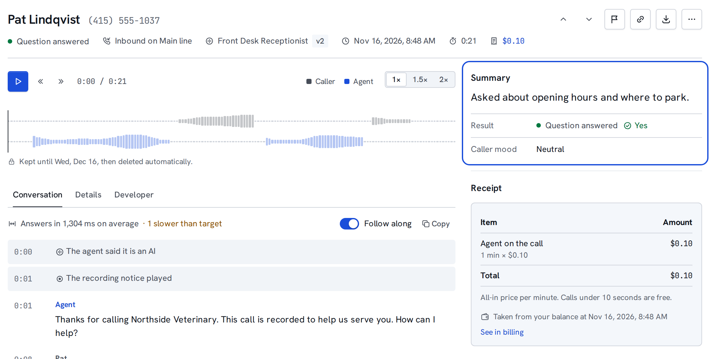

After a call ends, Larynth writes a short summary of it.
The summary is always on the call page.
You choose where else it goes.

## On the call page

Open **Calls** and select a call.
The summary sits next to the recording and the conversation.
It usually arrives within 30 seconds of the call ending.
Until then, the page shows **Summary on the way**.

<Frame caption="The summary sits beside the recording and conversation.">
  
</Frame>

See [Summaries and extraction](/concepts/summaries) for what a summary contains and how to add your own fields.

## Get a summary after every call

Call summaries are off for everyone until they turn them on.
Each teammate chooses their own.

<Steps>
  <Step title="Open notification settings">
    Go to **Settings** ▸ **Notifications**.
    Under **Other notifications**, select **Edit**.
  </Step>

  <Step title="Turn on Call summaries">
    In the **Call summaries** row, turn on each place you want them.
    Emails go to the address you sign in with.
  </Step>

  <Step title="Add more places if you want them">
    The list shows a column only for places that are set up.
    See the table below.
  </Step>
</Steps>

| Where | How to set it up |
| - | - |
| Email | Ready to use. |
| Push | Under **Browser notifications**, select **Turn on for this device**. Then use **Send a test**. |
| Slack | Under **Workspace channels**, select **Connect Slack**. Owners and Admins only. |
| Telegram | Under **Workspace channels**, select **Connect Telegram**, open the link in Telegram and press **Start**. Owners and Admins only. |
| Webhook | Add an endpoint under **Developers** and subscribe it to notification events. See [Webhooks](/webhooks/overview). |

Use **Send a test** on a Slack or Telegram channel to check it works.

## Call alerts

Call alerts tell you about the calls that matter, instead of every call.
Find them at the top of **Settings** ▸ **Notifications**, under **Call alerts**.
Each one is off until you turn it on.

| Alert | When it is sent |
| - | - |
| **Caller wants a callback** | The caller asked to be called back. |
| **Caller wanted to book and didn't** | The call ended without the caller getting what they wanted. |
| **Caller sounded unhappy** | The caller's mood was negative. |
| **Every call** | After every answered call. |
| **A summary couldn't be made** | The summary step failed on a call. |
| **Caller says an urgent word (live)** | The caller says a word such as "emergency" or "leak", while the call is still on. |

When you turn one on, it goes by push and email to Owners and Admins, for incoming calls.
Select **Edit** to change who hears about it, how it is sent and which agents it covers.
You can also select **New alert** to build your own.
Owners and Admins can change alerts.

## Other updates you get

- **Weekly report**: calls answered, bookings, minutes and spend for the week, in one email. It is on by default.
- **Low balance**: an email when your credit falls to $10 and again at $2. Sent to Owners and Admins.

## Why didn't I get one?

<AccordionGroup>
  <Accordion title="Call summaries are off">
    Summaries are off until you turn them on.
    Check the **Call summaries** row in **Settings** ▸ **Notifications** ▸ **Other notifications** ▸ **Edit**.
    Each teammate sets their own, so turning them on for you does not turn them on for others.
  </Accordion>

  <Accordion title="The channel is not connected">
    A Slack, Telegram or webhook column appears only after it is connected.
    For push, turn on browser notifications on each device you use.
    If your browser blocks notifications for the site, allow them in your browser settings, then try again.
  </Accordion>

  <Accordion title="The summary is still on its way">
    A summary usually takes under 30 seconds.
    The notification is sent when the summary is ready.
  </Accordion>

  <Accordion title="The summary failed">
    The call page shows **Summary failed.** with a **Try again** button.
    Turn on the **A summary couldn't be made** alert to hear about these.
  </Accordion>

  <Accordion title="The call was too short">
    Calls under 10 seconds from answer to hang-up are not summarised.
    The call page shows **Too short to summarise.**
  </Accordion>

  <Accordion title="There was nothing to summarise">
    No summary is made when the call was not answered, or the caller did not speak.
    The call page says which.
  </Accordion>

  <Accordion title="The summary is turned off for the agent">
    Each agent can turn its summary off.
    Open the agent, go to **After each call** and check that **Write a summary** is on.
    If you change it, publish the agent again.
  </Accordion>

  <Accordion title="The email went to spam">
    Check your spam or junk folder.
    Mark the email as not spam so the next one arrives in your inbox.
  </Accordion>
</AccordionGroup>

Still missing one? Email [support@larynth.com](mailto:support@larynth.com) with the call ID. See [Support](/help/support).
