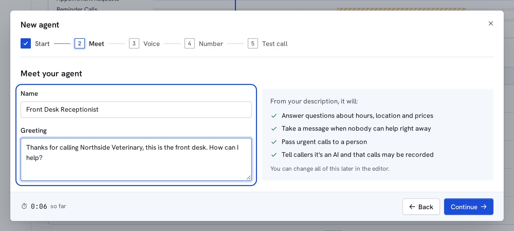
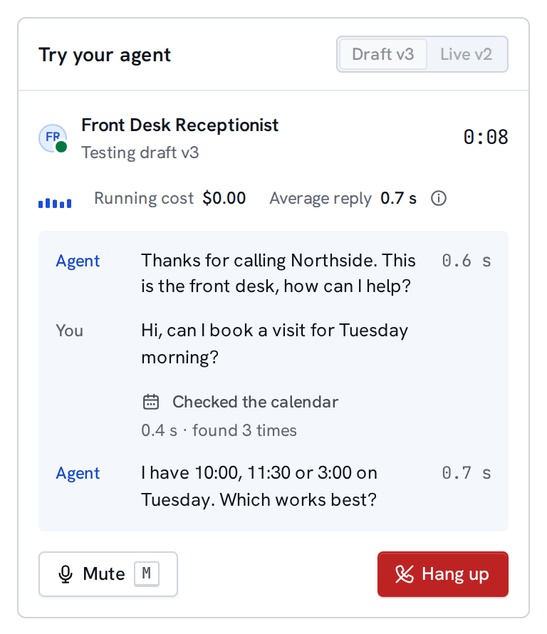
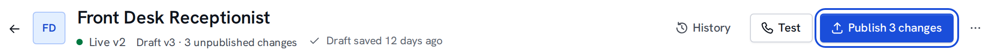
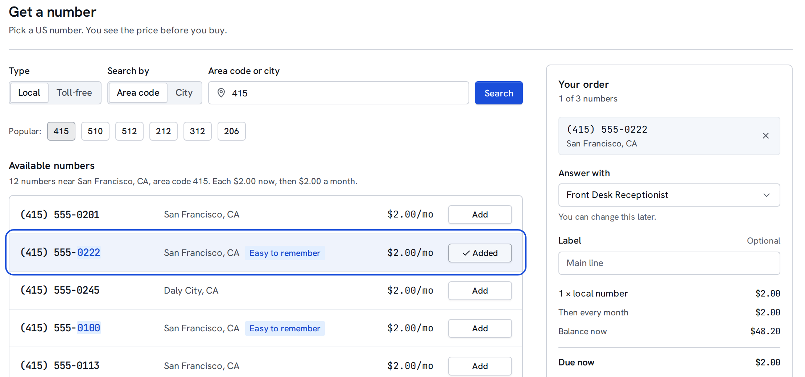
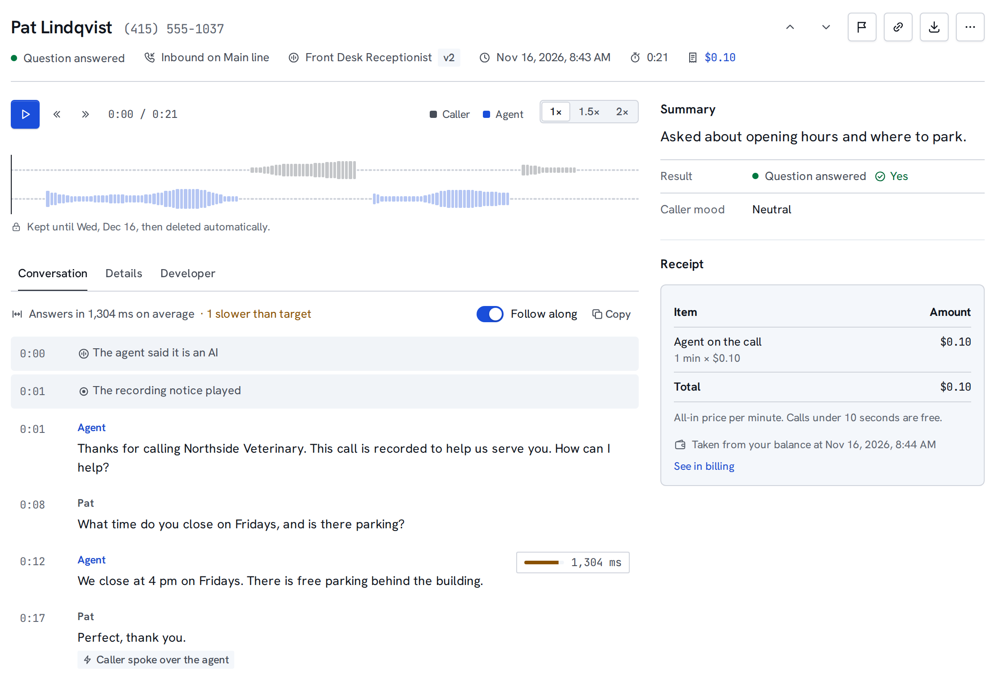

Make your first call in a few minutes.
You can talk to your agent in the browser before you buy a number.

<Info>
  **You need:** a Larynth account. Sign up takes a minute.
  **Time to first call:** a few minutes.
  **Free credit:** every new account gets $5 for browser and inbound test calls.
</Info>

Pick the path you want.

<Tabs>
  <Tab title="In the dashboard">
    <Steps>
      <Step title="Create an account">
        [Sign up](https://app.larynth.com/signup).
        Every new account gets $5 of free credit for browser and inbound test calls.
        Outbound calling needs verification and a paid top-up.
      </Step>

      <Step title="Create an agent">
        In the [dashboard](https://app.larynth.com), create an agent.
        Start from your website, a short description of your business or an industry template, and Larynth writes the instructions for you.
        Then check the name and greeting, and choose a voice.

        <Frame caption="Name your agent and write its greeting.">
          
        </Frame>

        You can edit the instructions later in the agent editor.
        Write them the way you would brief a new front-desk hire: what the business does, what callers usually want, what to collect, and when to hand the call to a person.
      </Step>

      <Step title="Test it in your browser">
        Start a browser call from the agent page and talk to it.
        Browser calls use your free credit.
        If something sounds wrong, change the instructions and test again.
        See [Test calls](/help/test-in-browser).

        <Frame caption="Talk to your agent and watch the transcript.">
          
        </Frame>
      </Step>

      <Step title="Publish the agent">
        Publishing freezes the version that callers reach.
        Later edits create a new draft, so a change never reaches live callers until you publish it.
        See [Agents](/concepts/agents).

        <Frame caption="Select Publish to put your changes live.">
          
        </Frame>
      </Step>

      <Step title="Add a phone number">
        Order a US or Canadian number for $2 per month, and point it at your agent.
        Buying a number needs a paid top-up, because free credit does not cover rental.
        Or keep your current number and forward calls to the new one.
        See [Get a number](/help/get-a-number) and [Forward your number](/help/forward-your-number).

        <Frame caption="Pick a number and choose which agent answers it.">
          
        </Frame>
      </Step>

      <Step title="Call it">
        Call the number from your own phone.
        When the call ends, open it in the dashboard to read the transcript and the summary.

        <Frame caption="Your first call: recording, summary and transcript.">
          
        </Frame>
      </Step>
    </Steps>

    <Check>
      Your call shows in **Calls** with a transcript and a summary.
    </Check>
  </Tab>

  <Tab title="With the API">
    <Info>
      **You need:** an API key from the dashboard.
      Keys look like `lx_<key_id>_<secret>`.
      Keep it in the environment, never in code.
    </Info>

    <Steps>
      <Step title="Set up your key">
        <CodeGroup>

        ```bash curl
        export LARYNTH_API_KEY="lx_test_..."
        ```

        ```ts TypeScript
        // npm install @larynth/sdk   (Node 24 or newer)
        import { configure } from "@larynth/sdk";

        configure({
          apiKey: process.env.LARYNTH_API_KEY!,
          baseUrl: "https://api-us.larynth.com",
        });
        ```

        ```python Python
        # pip install larynth   (Python 3.11 or newer)
        import os

        from larynth import authenticated_client

        client = authenticated_client(
            api_key=os.environ["LARYNTH_API_KEY"],
            base_url="https://api-us.larynth.com",
        )
        ```

        </CodeGroup>
      </Step>

      <Step title="Create an agent">
        In the API an agent is called an assistant.

        <CodeGroup>

        ```bash curl
        curl https://api-us.larynth.com/v1/assistants \
          -H "Authorization: Bearer $LARYNTH_API_KEY" \
          -H "Content-Type: application/json" \
          -d '{"name": "Front desk"}'
        ```

        ```ts TypeScript
        import { createAssistant } from "@larynth/sdk";

        const { data: assistant } = await createAssistant({
          body: { name: "Front desk" },
          throwOnError: true,
        });
        ```

        ```python Python
        from larynth.generated.api.assistants import create_assistant
        from larynth.generated.models import CreateAssistantRequest

        assistant = create_assistant.sync(
            client=client,
            body=CreateAssistantRequest(name="Front desk"),
        )
        ```

        </CodeGroup>

        The response includes the agent `id`.
      </Step>

      <Step title="Create the first draft version">
        `mode`, `language`, `system_prompt` and `greeting_text` are required.
        In `cascade` mode also pass the speech, language and voice model IDs.
        List them with `GET /v1/catalog/models` and `GET /v1/catalog/voices`.

        <CodeGroup>

        ```bash curl
        curl https://api-us.larynth.com/v1/assistants/$ASSISTANT_ID/versions \
          -H "Authorization: Bearer $LARYNTH_API_KEY" \
          -H "Content-Type: application/json" \
          -d '{"mode": "cascade", "language": "en-US", "system_prompt": "You answer calls for a dental clinic. Collect the caller name and reason for calling.", "greeting_text": "Hello, how can I help?", "stt_model_id": "'"$STT_MODEL_ID"'", "llm_model_id": "'"$LLM_MODEL_ID"'", "tts_model_id": "'"$TTS_MODEL_ID"'", "tts_voice_id": "'"$VOICE_ID"'"}'
        ```

        ```ts TypeScript
        import { createAssistantVersion } from "@larynth/sdk";

        const { data: version } = await createAssistantVersion({
          path: { id: assistant.id },
          body: {
            mode: "cascade",
            language: "en-US",
            system_prompt:
              "You answer calls for a dental clinic. Collect the caller name and reason for calling.",
            greeting_text: "Hello, how can I help?",
            stt_model_id: process.env.STT_MODEL_ID!,
            llm_model_id: process.env.LLM_MODEL_ID!,
            tts_model_id: process.env.TTS_MODEL_ID!,
            tts_voice_id: process.env.VOICE_ID!,
          },
          throwOnError: true,
        });
        ```

        ```python Python
        import uuid

        from larynth.generated.api.assistants import create_assistant_version
        from larynth.generated.models import AssistantVersionSpec

        version = create_assistant_version.sync(
            assistant.id,
            client=client,
            body=AssistantVersionSpec(
                mode="cascade",
                language="en-US",
                system_prompt="You answer calls for a dental clinic. Collect the caller name and reason for calling.",
                greeting_text="Hello, how can I help?",
                stt_model_id=uuid.UUID(os.environ["STT_MODEL_ID"]),
                llm_model_id=uuid.UUID(os.environ["LLM_MODEL_ID"]),
                tts_model_id=uuid.UUID(os.environ["TTS_MODEL_ID"]),
                tts_voice_id=uuid.UUID(os.environ["VOICE_ID"]),
            ),
        )
        ```

        </CodeGroup>

        The response includes the version number.
      </Step>

      <Step title="Publish it">
        <CodeGroup>

        ```bash curl
        curl -X POST https://api-us.larynth.com/v1/assistants/$ASSISTANT_ID/versions/1/publish \
          -H "Authorization: Bearer $LARYNTH_API_KEY"
        ```

        ```ts TypeScript
        import { publishAssistantVersion } from "@larynth/sdk";

        await publishAssistantVersion({
          path: { id: assistant.id, v: version.version },
          throwOnError: true,
        });
        ```

        ```python Python
        from larynth.generated.api.assistants import publish_assistant_version

        publish_assistant_version.sync(assistant.id, version.version, client=client)
        ```

        </CodeGroup>
      </Step>

      <Step title="Search for a number">
        <CodeGroup>

        ```bash curl
        curl "https://api-us.larynth.com/v1/numbers/available?country=US&area_code=415&limit=5" \
          -H "Authorization: Bearer $LARYNTH_API_KEY"
        ```

        ```ts TypeScript
        import { searchAvailableNumbers } from "@larynth/sdk";

        const { data: found } = await searchAvailableNumbers({
          query: { country: "US", area_code: "415", limit: 5 },
          throwOnError: true,
        });
        ```

        ```python Python
        from larynth.generated.api.numbers import search_available_numbers

        found = search_available_numbers.sync(
            client=client, country="US", area_code="415", limit=5
        )
        ```

        </CodeGroup>
      </Step>

      <Step title="Order it and route it to the agent">
        Ordering a number needs a paid top-up.
        The number costs $2 per month.

        <CodeGroup>

        ```bash curl
        curl https://api-us.larynth.com/v1/numbers \
          -H "Authorization: Bearer $LARYNTH_API_KEY" \
          -H "Idempotency-Key: $(uuidgen)" \
          -H "Content-Type: application/json" \
          -d '{"e164": "+14155550123", "route_type": "assistant", "assistant_id": "'"$ASSISTANT_ID"'"}'
        ```

        ```ts TypeScript
        import { randomUUID } from "node:crypto";
        import { orderNumber } from "@larynth/sdk";

        const { data: number } = await orderNumber({
          headers: { "Idempotency-Key": randomUUID() },
          body: {
            e164: found.data[0].e164,
            route_type: "assistant",
            assistant_id: assistant.id,
          },
          throwOnError: true,
        });
        ```

        ```python Python
        from larynth.generated.api.numbers import order_number
        from larynth.generated.models import OrderNumberRequest

        number = order_number.sync(
            client=client,
            idempotency_key=str(uuid.uuid4()),
            body=OrderNumberRequest(
                e164=found.data[0].e164,
                route_type="assistant",
                assistant_id=assistant.id,
            ),
        )
        ```

        </CodeGroup>

        Ordering is asynchronous.
        Fetch the number until `status` is `active`.

        <CodeGroup>

        ```bash curl
        curl https://api-us.larynth.com/v1/numbers/$NUMBER_ID \
          -H "Authorization: Bearer $LARYNTH_API_KEY"
        ```

        ```ts TypeScript
        import { getNumber } from "@larynth/sdk";

        const { data: current } = await getNumber({
          path: { id: number.id },
          throwOnError: true,
        });
        console.log(current.status);
        ```

        ```python Python
        from larynth.generated.api.numbers import get_number

        current = get_number.sync(number.id, client=client)
        print(current.status)
        ```

        </CodeGroup>
      </Step>

      <Step title="Call it, then read the call">
        Call the number from your own phone.
        Then list your latest call.

        <CodeGroup>

        ```bash curl
        curl "https://api-us.larynth.com/v1/calls?limit=1" \
          -H "Authorization: Bearer $LARYNTH_API_KEY"
        ```

        ```ts TypeScript
        import { listCalls } from "@larynth/sdk";

        const { data: calls } = await listCalls({
          query: { limit: 1 },
          throwOnError: true,
        });
        console.log(calls.data[0].call_id, calls.data[0].status);
        ```

        ```python Python
        from larynth.generated.api.calls import list_calls

        calls = list_calls.sync(client=client, limit=1)
        print(calls.data[0].call_id, calls.data[0].status)
        ```

        </CodeGroup>
      </Step>
    </Steps>

    <Check>
      The list returns your call.
      Its summary is available from `GET /v1/calls/{call_id}/analysis` once the call ends.
    </Check>

    <Note>
      The numbers above are fictional.
      Use a number returned by the search.
    </Note>
  </Tab>
</Tabs>

## Common problems

<AccordionGroup>
  <Accordion title="I called the number and nothing answered">
    Check these in order.

    - The number's status must be **Active**, not `ordering`. Ordering takes a short while.
    - The number must be routed to your agent, not to a forward or to nothing.
    - The agent must have a published version. A draft never reaches callers.

    Then call again from a different phone.
    Still silent? See [Test calls](/help/test-in-browser) and [Get a number](/help/get-a-number).
  </Accordion>

  <Accordion title="The browser call does not connect">
    Allow microphone access for the dashboard when your browser asks.
    Try another network, and use a current Chrome, Edge, Firefox or Safari.
    See [Test calls](/help/test-in-browser).
  </Accordion>

  <Accordion title="The number order was refused">
    Free credit does not cover number rental.
    Make a paid top-up first, then order again.
    The API code is `numbers.paid_top_up_required`.
  </Accordion>

  <Accordion title="The API returns 401 or 403">
    A `401` means the key is missing, malformed or revoked.
    A `403` with `auth.scope_missing` means the key lacks a scope for that endpoint.
    See [Authentication](/api-reference/authentication).
  </Accordion>

  <Accordion title="I want to keep my current number">
    Larynth does not port numbers yet.
    Forward your current number to the new one.
    See [Forward your number](/help/forward-your-number).
  </Accordion>
</AccordionGroup>

## Next

<CardGroup cols={2}>
  <Card title="Concepts" icon="book-open" href="/concepts/agents">
    How agents, numbers, calls and billing work.
  </Card>
  <Card title="SDKs" icon="package" href="/sdks/typescript">
    Use the TypeScript or Python SDK (0.1 beta) instead of raw HTTP.
  </Card>
</CardGroup>
